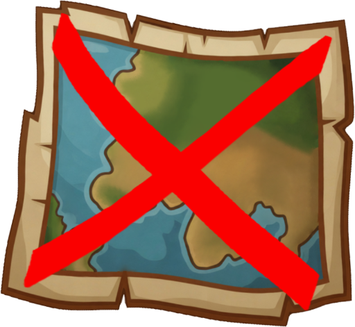
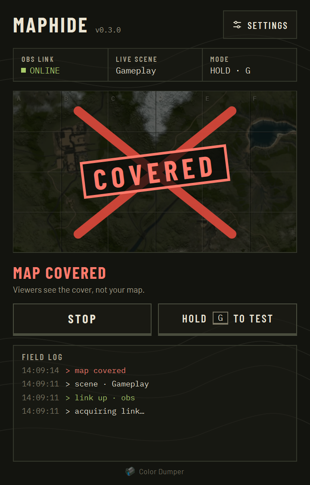
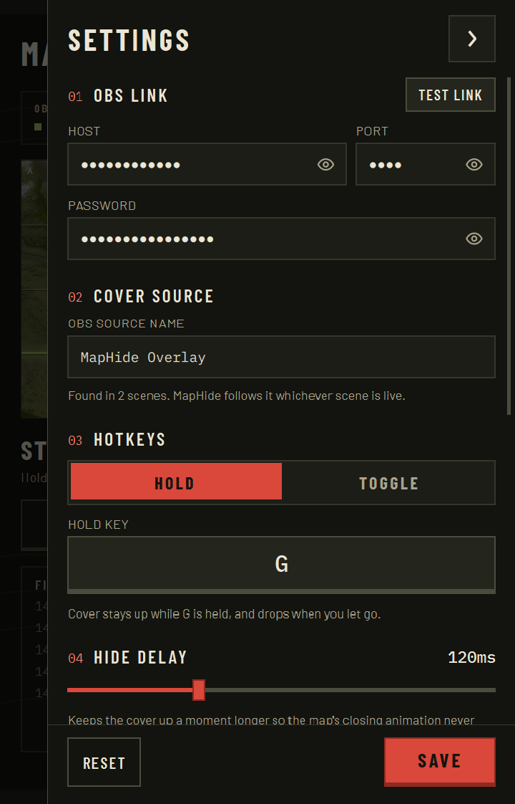

   
  <b>MapHide</b> 
  Cover your in-game map on stream with one key, from your gaming PC.

  
  
  
  
  

  

  

MapHide runs on your gaming PC and listens for your map key. When you open the map in game, it tells OBS on your streaming PC to show a cover over it, and hides the cover again when you close the map. It works with any game where viewers shouldn't see your map, GPS or a similar part of the screen.

- [Features](#features)
- [See it in action](#see-it-in-action)
- [Quick start](#quick-start)
- [Full dual-PC setup](#full-dual-pc-setup)
- [Keys](#keys)
- [Updating and uninstalling](#updating-and-uninstalling)
- [Troubleshooting](#troubleshooting)
- [Settings file and debug log](#settings-file-and-debug-log)
- [Anti-cheat](#anti-cheat)

## Features

- **Hold or toggle.** Hold mode covers the map while you hold your key. Toggle mode covers it on one press and uncovers it on the next, or uses a separate hide key such as `Esc`.
- **Follows your scenes.** MapHide follows the live OBS scene and controls the same source in every scene that has it.
- **No flash on close.** A hide delay keeps the cover up through a map's closing animation.
- **See what's happening.** The window shows the OBS link, the live scene, whether your map is covered, and a short log. It never shows your OBS address.
- **Test without the game.** Test Link checks your OBS details, and the Hold G to test button covers and uncovers the map the same way your key does.
- **Stays out of the way.** Closes to the tray, can connect when it opens, reconnects if OBS restarts, and its preview animation pauses while your game is in front.
- **Updates itself.** Check for updates in Settings installs a new version and keeps your settings.

## See it in action

MapHide covering the map in Rust, with OBS on the streaming PC and the game on the gaming PC:

## Quick start

For the usual setup: OBS on a streaming PC, your game on a gaming PC, both on the same network.

1. **On the streaming PC**, open OBS, go to `Tools > WebSocket Server Settings`, turn on the server and note the port (usually `4455`) and the password.
2. **On the streaming PC**, add the source that covers your map (an image, for example) to every scene you stream from, and give it a name you can type exactly, such as `MapHide Overlay`.
3. **On the gaming PC**, download `MapHide-vX.Y.Z-setup.exe` from the [latest release](https://github.com/ColorDumper/MapHide/releases/latest) and run it. If Windows says it protected your PC, click More info, then Run anyway.
4. Open MapHide, click Settings and enter the streaming PC's local IP address, the port, the password and the source name. Click Test Link to check them, then Save.
5. Close Settings, click Start, and hold the Hold G to test button. The cover should appear in OBS.

Not working? See the [full setup](#full-dual-pc-setup) and [troubleshooting](#troubleshooting).

MapHide can also run on a single PC with OBS, but it is built for two. On one PC, an OBS script may be simpler.

## Full dual-PC setup

MapHide runs on the **gaming PC**, where it reads your key. OBS runs on the **streaming PC**, where MapHide tells it to show or hide the cover over your local network. MapHide is not meant to run on the streaming PC.

You need:

- Windows 11 on the gaming PC (Windows 10, version 1809 or later, should work too, but hasn't been tested yet)
- OBS Studio on the streaming PC (WebSocket is built into OBS 28 and later, so there's nothing extra to install)
- A source in OBS that covers your map
- Both PCs on the same local network

### 1. Streaming PC: turn on the OBS WebSocket server

1. Open OBS Studio.
2. Go to `Tools > WebSocket Server Settings`.
3. Turn on the WebSocket server.
4. Note the server port. It is usually `4455`.
5. Set a password, ideally one you don't use anywhere else.
6. Click Apply.

### 2. Streaming PC: create the cover source

1. In OBS, add the source you want MapHide to show and hide.
2. Give it a name that's easy to type exactly, such as `MapHide Overlay`.
3. Add that same source to every scene where you want MapHide to work. Add it to each scene directly: a source inside a group, or shown through a nested scene, isn't found.
4. Make sure it covers the map area in your game.

If you need a cover image, you can make your own or use a community one. One source is [Sendox on YouTube](https://www.youtube.com/@sendox).

### 3. Streaming PC: find its local IP address

1. Open Command Prompt or PowerShell.
2. Run `ipconfig`.
3. Note the IPv4 address of the network adapter you're using, such as `192.0.2.10`.

That address is what MapHide connects to.

### 4. Gaming PC: install and set up MapHide

1. Download `MapHide-vX.Y.Z-setup.exe` from the [latest release](https://github.com/ColorDumper/MapHide/releases/latest) and run it. MapHide is not code-signed, so Windows may show "Windows protected your PC": click More info, then Run anyway.
2. Open MapHide from the Start menu and click Settings.
3. Enter the streaming PC's OBS details:
   - **Host**: the streaming PC's local IP address
   - **Port**: the OBS WebSocket port, usually `4455`
   - **Password**: the OBS WebSocket password
   - **OBS Source Name**: the exact name of the cover source in OBS
4. Click Test Link. MapHide connects to OBS once and tells you how many scenes have your source.
5. Choose Hold if your game's map is open only while you hold a key, or Toggle if it opens and closes with key presses.
6. Click the key cap and press the key you open the map with.
7. Adjust the hide delay if needed, then click Save.

  

### 5. Test it

1. Close Settings and click Start.
2. Hold the Hold G to test button (it says Press in toggle mode, and shows your own key). The cover should appear in OBS, and the map preview in MapHide shows Covered.
3. Switch between OBS scenes that have the source, and try again.
4. Open your game and press your map key. The cover should appear and hide in OBS.

If the map shows for a split second as it closes, raise the hide delay a little.

<b>If it can't connect: the streaming PC's firewall</b>

If MapHide can't connect while both PCs are on the same network and the password is right, Windows Firewall on the streaming PC may be blocking OBS.

1. Open Windows Security.
2. Go to Firewall & network protection.
3. Click Allow an app through firewall.
4. Make sure OBS Studio is allowed on the network profile you're using.
5. If that isn't enough, add an inbound rule for TCP port `4455`.

## Keys

- **Hold mode**: any letter, `A` to `Z`.
- **Toggle mode, show key**: any letter, `A` to `Z`.
- **Toggle mode, hide key**: a letter, `Esc`, `Shift`, or `Shift` plus a letter.

The hide key can be `Esc` or `Shift` plus a letter because some games open the map with one key and close it with another. In toggle mode, using the same key for both makes each press switch the cover on or off.

MapHide reads your keys whichever window is in front, so they also work while you type in game chat, Discord or a browser. Keep that in mind when choosing them.

## Updating and uninstalling

MapHide checks for a new version each time it opens (turn this off with Check for updates under Behavior in Settings). When one is out, the log says so: click Update under About in Settings, and MapHide closes, updates and opens again with your settings kept. You can also run a newer setup file yourself.

**Coming from v0.2.6 or older** (the zip): close the old MapHide, then run the setup file once. Your settings carry over, and you can delete the old folder afterwards.

**Rather not install it?** Each release also has `MapHide-vX.Y.Z-win64.zip`: unzip it anywhere and run `MapHide.exe`. This copy doesn't update itself. When a new version is out, Get it under About in Settings opens the download page.

To remove MapHide, use Settings > Apps > Installed apps in Windows. It asks whether to keep your settings.

What changed in each version is in the [changelog](CHANGELOG.md).

## Troubleshooting

<b>MapHide can't connect to OBS</b>

Check these in order:

1. MapHide is running on the **gaming PC**.
2. OBS is open on the **streaming PC**.
3. In OBS on the streaming PC, `Tools > WebSocket Server Settings` shows the server turned on, with the port and password you entered.
4. Host in MapHide is the **streaming PC's local IP address**, not the gaming PC's, not `127.0.0.1` and not a public internet address.
5. Both PCs are on the same local network.
6. The streaming PC's firewall allows OBS (see the firewall note at the end of [Full dual-PC setup](#full-dual-pc-setup)).

If the details were wrong, MapHide stops and says why. Fix them, click Save, then click Start. If OBS just isn't open yet, MapHide keeps trying on its own.

<b>MapHide connects, but nothing happens in OBS</b>

Check that:

- The source name matches the name in OBS exactly.
- The source is in the live scene, and in every scene you want MapHide to follow.
- The source sits in each scene directly, not inside a group or a nested scene.
- The right mode, Hold or Toggle, is chosen.
- You clicked Save after changing your key.

Test Link in Settings tells you how many scenes have the source.

<b>The cover disappears too fast, or stays too long</b>

Raise the hide delay in Settings if your map shows for a moment as it closes, or lower it if the cover stays up too long. Then click Save.

<b>Closing the window doesn't quit MapHide</b>

That's on purpose: closing the window keeps MapHide running in the tray. To quit, right-click the tray icon and click Exit. MapHide hides the cover in OBS before it closes.

<b>Opening MapHide again just brings the window back</b>

Only one copy runs at a time. Opening it again brings the open window to the front, even from the tray.

## Settings file and debug log

<b>Where settings are kept</b>

MapHide keeps your settings in `%AppData%\MapHide\config.json`, for example `C:\Users\YourName\AppData\Roaming\MapHide\config.json`. You never need to edit it: MapHide writes it when you click Save. To start over, click Reset in Settings, then click it again to confirm.

This file is plain text, and that includes your OBS WebSocket password: any program running as your Windows user can read it (OBS stores its own copy the same way). The connection between MapHide and OBS also crosses your local network unencrypted. For both reasons, use a WebSocket password you don't use anywhere else.

<b>Turning on the debug log</b>

If MapHide misbehaves and you want to report it, turn on Debug log under Behavior in Settings, click Save, and make the problem happen again. MapHide then writes what it's doing (connecting, scene changes, showing and hiding the cover, and errors) to `%AppData%\MapHide\maphide-debug.log`.

The log never contains your OBS password. It's off by default, starts fresh each time you open MapHide (the two runs before are kept next to it as `maphide-debug.1.log` and `maphide-debug.2.log`), and stays small. Turn the switch off again to stop logging. Attach it when you [report a problem](https://github.com/ColorDumper/MapHide/issues).

## Anti-cheat

MapHide only **reads** whether a key is down, through a standard Windows function many streaming and macro tools use. It doesn't send keystrokes, hook into the game, read or write game memory, or touch any game files.

It is not code-signed and checks the keyboard continuously, which a kernel-level anti-cheat could in principle treat as suspicious. Use it at your own discretion.

## Credits

Created by [Color Dumper](https://github.com/ColorDumper). Released under the [MIT license](LICENSE).
